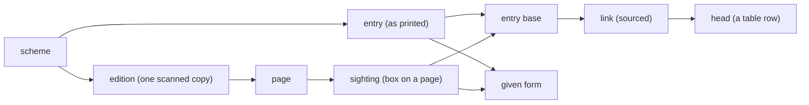

# 簡化字譜 · Simplified Han Compared

Status: plan. Nothing is built. Site: `https://hans.glyphatlas.org`. Repository: `mkpoli/han-simplified`, in `~/projects/Philology/han-simplified`.

## 1. What it is

A site of Glyph Atlas that compares every Han-character simplification scheme: which form each one gives each character, shown as the form was printed. Each claim opens the page of the book it stands on, with the place marked.

| Name | |
|---|---|
| zh-Hant / zh-Hans | 簡化字譜 / 简化字谱 |
| en | Simplified Han Compared |
| ja / ko | 漢字簡略化対照 / 한자 간략화 비교 (drafts; a native reader checks them) |
| vi | to be named by a native reader |

`hans` is also the script subtag for simplified Han (`Hans`), so the address reads the same in every language.

Scope: official schemes, adopted, withdrawn or only drafted, and the 1934–35 手頭字 list as the one civic scheme. Out of scope: folk forms outside any scheme, 拡張新字体, and variant-only lists (第一批異體字整理表 and its kin) except as a source for links.

## 2. Decisions

| Topic | Decision |
|---|---|
| Photos | The print is the main view. Every table cell can show the photographed glyph; every photographed glyph opens its page with the box drawn |
| Pairs | Stored exactly as printed: base, form, section, page, footnote. Nothing is normalised to traditional |
| Joins | A separate table, each link with its source and relation type |
| Unencoded forms | Shown by photo first, IDS second. Own stable IDs. No private-use codes anywhere in data or pages |
| Lines in 譜 | Colour is the source of the link. Solid is regular, dashed is limited to a sense. Withdrawn is a property of a scheme and stands on its heading |
| Rows of 表 | One head character each. 發 and 髮 are two rows that both show 发, so a merge never fuses rows and an address never changes |
| State of a scheme | `checked` (read against the print), `transcribed` (from a compilation), `listed` (no source held) |
| Storage | Data as TSV in the repository, built to static JSON. No database. Images in R2 |
| Editing | Read-only in 1.0. Corrections by repository issue |

## Scheme IDs

`<country>-<year>[-<slug>]`, in data and addresses: `cn-1935`, `cn-1955-draft`, `cn-1955-rev`, `cn-1964`, `cn-1977`, `cn-1981`, `jp-1949`, `jp-1981`, `kr-1967-11`, `kr-1967-12`, `sg-1969`, `my-1981`. Bare years collide (1955, 1967, 1981).

Each scheme has a coverage: `diff` lists only the characters it changes (1935, 1964, 1977), `inventory` lists every character it covers (1949, 2013).

## 3. Schemes and the book photos for each

"Opened" means a page image was looked at while planning. Pair counts are brackets parsed from 文字改革相关字表整理 6.2.0 (the compilation, 141 pages, 2026-07-01), and include its editor's additions; they are sizes for planning, not results.

### China

| Scheme | Photo source | Opened | Pairs in compilation |
|---|---|---|---|
| 1934 手頭字 | local scan, 4 pp., 1419×2166 colour, library watermark | yes (signatory page only; locate the appended table) | none |
| 1935 第一批簡體字表 | Commons `NLC416-08jh009497-19562 簡體字表.pdf`, 36 pp., 1645×2271 bilevel; two other copies on Commons | file only | 635 (compilation heads it 1936; Wikisource gives 民國24年8月21日) |
| 1955 汉字简化方案草案 | IA `20220420_20220420_0258`, 16 pp., 2149×3035 colour | yes | 1,523 |
| 1955 修正草案 | none held; the compilation marks it missing | – | none |
| 1956 汉字简化方案 | IA `hanzi_jianhua_fangan_1956_20220420`; Commons djvu, 11 pp., 2982×4350 | no | 567 |
| 1963 简化汉字修订方案（草案） | IA `jianhuahanzi_xiudingfangan_1963`, 16 pp., 1376×1947 colour | file only | 3,010 |
| 1964 简化字总表 | IA `jianhuazi_1964_20220420`; local scan, bilevel | yes (local, p. 10) | 2,801 |
| 1975 二简（草案） | none found | – | 881 |
| 1977 二简（草案） | local colour scan, 8 pp., 2694×3696; also IA `secondsimplification_20220420`, Commons | yes (pp. 1–3, 5) | 1,480 |
| 1981 修订草案征求意见表 | Commons, 8 pp., 8918×12620; IA `20220708_20220708_1633` | no | 340 |
| 1985 增订方案（草案） | zhuanlan.zhihu.com/p/1949056792656090522 is reported to carry a scan; it refuses automated reading, so a person opens it | no | 315 |
| 1986 简化字总表 | IA `jianhuazi_1986_old_20200823` and `jianhuazi_1986_new_20200823`; titles and identifiers disagree on old/new, check the colophon | no | revision list only |
| 2013 通用规范汉字表 | Commons, 137 pp. | no | – |

The Zhihu collection p/1949165992052778676 (碎叶斋, post-1949 simplification papers) is the first place to look for 1975 and the 1955 revision.

### Japan (文化庁 国語施策沿革資料 11 and 12, 400 dpi bilevel spreads, 4644×3228)

| Scheme | File(s) | Opened |
|---|---|---|
| 1919 漢字整理案, with 許容體 | `11_133`–`11_247` | no |
| 1931 常用漢字表 | `11_292`, `11_303` | no |
| 1938 漢字字体整理案 | `11_316`–`11_367` | p. 330 |
| 1942 標準漢字表, 簡易字体 | `11_372`–`11_402` | p. 402 |
| 1946 当用漢字表 | `12_001` | yes |
| 1947 活字字体整理案 | `12_004`–`12_023` | p. 14 |
| 1949 当用漢字字体表 | `12_028`–`12_049`; also 官報 1949-04-28 on Commons (`NDL2963228`) | p. 38 |
| 1981, 2010 常用漢字表 | official PDFs, to fetch | no |
| 1923 常用漢字表, 1926 字体整理案 | not in these two volumes | – |

### Korea, Singapore, Malaysia

| Scheme | Photo source |
|---|---|
| Korea 1967, 542 forms | one newspaper image, 1280 px, date unread. The 1967-11-11 papers in Naver News Library are the target for a legible copy |
| Korea 1967-12, reduced list (reported 198) | none |
| Singapore 1969, 1974, 1976 | none held; WG2 N3695 tabulates 77 forms of 1969. The National Library of Singapore is reported to hold the books (zhuanlan.zhihu.com/p/18931770638) |
| Malaysia 1981 | none |

A scheme with no source stands in the scheme index as `listed` and is left out of the table until it has one.

## 4. Pages

Locales: en, ja, zh-Hant, zh-Hans, ko, vi, as on the Rare Character Compendium. Every address below follows `/[locale]`; `/` redirects to the reader's locale, and `/design` stands outside it.

| Page | Address | Shows |
|---|---|---|
| 表 | `/` | One row per head character, one column per scheme |
| 譜 | `/compare/cn-1964/cn-1977` | Merges, splits and differences between two schemes |
| Character | `/char/發` | Every scheme's form as a strip of photos in date order, with footnote, page and links. `/char/发` lists its heads: 發, 髮. An unencoded form is at `/form/<id>` |
| Schemes | `/schemes` | Timeline by country with state, and what each one replaced or withdrew |
| Scheme | `/scheme/cn-1977` | Cover, sections, printed totals beside transcribed totals, page thumbnails |
| Book page | `/scheme/cn-1977/page/5` | The photo with every pair boxed; transcription beside it |
| Sources | `/sources` | Each copy used, where it came from, who supplied it |
| Data | `/data` | TSV and JSON, with the data's version |

### 表

```
 [簡化字譜 | GLYPH ATLAS]   表  譜  Schemes  Sources  Data                    [···]
 ----------------------------------------------------------------------------------
 Search [ 藏 or 艹上 or cáng          ]   Columns [China v]   Show [Photo|Type|Both]
 All  Differs  Merged  Split  Unencoded  China≠Japan
 ----------------------------------------------------------------------------------
 base |  1935  |  1955草 |  1964  |  1977草  |  1981  |  1949日 |  2010日
  藏  |   ·    | [photo] |   ·    | [photo]  | [photo]|  [photo]| [photo]
  餐  |   ·    | [photo] |   ·    | [photo]  | [photo]|    =    |    =
```

Cell states, distinct in shape as well as colour: one or more forms; `=` listed unchanged, possible only where coverage is `inventory`; `·` not listed. A `diff` scheme says nothing about what it leaves out, so `·` is never read as "kept".

In photo mode an entry with no scan (1975, 1985, an editor's addition) shows its typed form or IDS with a "no scan" mark and no page link.

Search covers characters, IDS parts and readings. Readings come from Unihan and the IDS of encoded forms from BabelStone, both cited on `/sources`; the index loads when the field takes focus.

Column presets: China, Japan, China and Japan, drafts only, all. The first column and header stay in place; rows are virtualised; filters and columns live in the address. Below 640 px each row becomes a card: base at left, a scrolling strip of schemes at right.

### 譜

Modelled on slide 9 of Ryusei Yamaguchi's 文字情報ハックのすすめ (CC BY 4.0): left scheme, variants in between, right scheme, one small drawing per connected cluster. Only clusters that are not one-to-one are drawn by default; "all differences" and "reversed" are the other two sets. Line colour names the source of the link; hover or focus on a line gives the citation and opens the photo. Nodes are photos or type, by the same switch as the table. A cluster is computed for the pair on view and has no address of its own. Where both schemes are `diff` (1964 and 1977), a head that one side leaves out gets an empty "not listed" node; nothing is filled in from outside.

### Character page

```
 發  fā                                              [Rare] [Han Input] [Unihan]
 1935 [photo]   1955草 [photo] … 1964 [photo]   1949日 [photo]
 p.12           p.3              p.10           p.40
 -- Merges with 髮 in 1955草, 1956, 1964  -- Separate in Japan
 -- Footnotes, verbatim
```

### Book page

Photo at left in the zoomable frame, with a box per pair; transcription at right in the book's order. Hovering or focusing either side marks the other. Arrow keys move by pair, page keys by page. Covers, prefaces and notes are included so that the scheme can be read as a book.

## 5. Design

The Rare Character Compendium is the reference for layout and controls; the tokens come from `@glyph-atlas/design-system`.

- **Tokens.** A script copies `tokens.css`, `base.css` and `components.css` from a pinned Glyph Atlas commit into `src/lib/design/`; it writes `manifest.json` with the commit and each file's sha256, and the unit test checks the copy against the manifest without network access. Bun cannot install a package from a subdirectory of a git repository.
- **Compendium overrides.** `--muted` `light-dark(#67676f, #a3a3ac)`; primary button on `--action-surface`; body 14 px, nothing under 12 px; `--mark #e0241b` for boxes on photos; page gutter and tile size as there.
- **Header.** Mark, name, rule, `GLYPH ATLAS` by-line, links with the 2 px underline on the current one, menu for language and scheme. The mark keeps the family's four squares, its fourth square reduced to a few strokes.
- **Photos.** Backed by `--scan-paper` and shown unchanged in dark mode. No filter, no thresholding; a bilevel scan stays bilevel. The focus ring and box sit outside the ink.
- **Han text.** `lang` on every form, set by its scheme and overridable by entry: the base of a 1977 entry is `zh-Hans` (懒), of a Japanese entry `ja`, of 1935 `zh-Hant`; font stacks from the Compendium's `:lang()` rules.
- **Link colours**, from the Compendium's tag palette so that light and dark pairs are already set:

| Link source | Token | Light / dark |
|---|---|---|
| Left scheme's own table | `--tag-language-ink` | `#154c8a` / `#84beff` |
| Right scheme's own table | `--tag-form-ink` | `#5c318a` / `#c79bff` |
| An official variant or standard table | `--tag-domain-ink` | `#19623b` / `#73d39a` |
| Unihan alone | `--tag-meta-ink` | `#872748` / `#f48eae` |
| Editor's link | `--tag-region-ink` | `#8b4300` / `#ffb067` |
| Same character | `--ink` | `#19191c` / `#e6e6ea` |

- **State badges.** `checked` on `--good-light`, `transcribed` on `--uncertain-badge`, `listed` on `--surface-sunken`; each carries its word.
- **Copy.** Labels and values only. Definitions sit in a help panel.

## 6. Data



| File | Fields |
|---|---|
| `schemes.tsv` | id, country, year, title, kind (adopted, withdrawn, draft, civic), coverage (diff, inventory), body, adopted_on, withdrawn_on, replaces, state |
| `editions.tsv` | id, scheme, title, imprint, holder, source_url, supplied_by, retrieved_on, sha256, note |
| `pages.tsv` | edition, seq, printed_label, side (full, left, right), raw_sha256, transform, width, height, image_key |
| `entries.tsv` | id, scheme, section, order, printed_row, kind (character, word, component), form, condition, footnote, origin (print, compilation, editor), check |
| `entry_bases.tsv` | entry, pos, form, lang; empty for an inventory that prints one glyph and no base |
| `sightings.tsv` | entry, edition, page, role (base, form), pos, x, y, w, h, as fractions of the deskewed page |
| `forms.tsv` | id, codepoint, ids, compendium_record: an abstract form, never one printing |
| `heads.tsv` | id, form, kind |
| `links.tsv` | form, head, relation, condition, source, citation, note |
| `rules.tsv` | scheme, component, reduced component, scope |
| `checks.tsv` | scheme, section, metric (entries, bases, forms, rules), printed, counted, note |

Cases the schema has to hold, all seen in the 1977 scan:

| Case | Example |
|---|---|
| Several bases, one form, joined by a brace | 芭 笆 粑 → 巴 |
| A word reduced as a unit | 叮咛 → 丁宁, 鹦鹉 → 婴武 |
| Base already simplified in an earlier scheme | 懒, 缆, 谰 |
| Footnote limiting a sense or reading | 潦 → 了, with 涝 in one sense |
| One base reduced differently by sense | 雕: 刁 for carving, another form for the bird (p. 5, footnote 1; that form is not yet read) |
| A component that never stands alone | 16 in Table 2 |

Rules:
- `origin=editor` marks the compilation's bracketed additions and every analogical form no book prints. They are off by default in the table.
- IDs are opaque and never reused. An IDS does not identify a form, since two forms can share one.
- A unified code point hides print differences, so encoded forms have sightings too.
- One printed row split by a footnote becomes one entry per condition sharing a `printed_row`. An entry can have sightings in several editions.
- A column never mixes schemes. 1946, 1949, 1981 and 2010 stay apart.

## 7. From book to data

1. **Intake.** Fetch each file, record URL, date and sha256, keep the original. Where copies compete, pick by legibility, then by colour; keep the others as further editions.
2. **Pages.** Extract the embedded images without resampling; split facing pages. Deskew into a derived copy and keep the transform. An ingest script, run by hand, writes WebP at 320, 1600 and full width, uploads them to R2 under content-hash names and commits `media-manifest.tsv`. The app build and CI never read a scan.
3. **First transcription.** Parse the compilation's text layer; add 字統網's 1935, 1977 and 1986 lists and Wikisource's 1977 and 1986 texts as second witnesses. Japan is read from the 文化庁 pages.
4. **Boxes.** Find columns and rows by projection, number the cells in reading order, align them to the transcription in order. A count mismatch stops the page for a person.
5. **Reading check.** A local page shows each cell's photo beside its transcription, one keystroke per verdict; disagreements between witnesses come first. Verdicts: same, different, illegible. A scheme is `checked` when every entry has a verdict and no difference is open; its illegible count is shown.
6. **Private-use forms.** About 1,700 distinct codes. Try 字統網's IDS by scheme and base, then a composition drawn beside the photo, then a person. The code is dropped once the form has its ID.
7. **Totals.** Compare with the totals the book prints, counting `origin=print` only and by the metric each total uses. The 1977 draft prints 172 + 21 + 55 = 248 for Table 1, 245 + 24 + 336 = 605 for Table 2, 853 in all, 61 components.
8. **Links.** Join through official tables first, Unihan after, by hand last; each row cites its source. Never chain through a link of a weaker kind without showing it.

Known faults in the compilation, as a floor for checking: 1977 籍 is 笈 in the print, 芨 in the compilation; 1956 歷曆 is 厉 there and 历 in 1955, 1963 and 1964; 1935 鹽 is 盐 there and 𥂁 in 字統網.

Every source is cited on `/sources` and in the row that uses it: the compilation by title, version and compiler, the uploader of each scan, the person who passed on the clipping, 字統網, Wikisource, 文化庁, and the slide for 譜.

## 8. Build

SvelteKit 5, `adapter-cloudflare`, Bun, TypeScript, one Worker, as in the Compendium. `routes: hans.glyphatlas.org, custom_domain`. R2 bucket `han-simplified` bound as `MEDIA`, served under `/media/`. Port the Compendium's `ZoomablePicture`, `MarkedPicture`, paging and header rather than importing them.

- The table loads `heads.json` and one JSON per visible scheme, so any set of columns loads only what it shows; target 300 KB compressed for the China preset.
- The ingest script cuts glyph photos 96 px high and packs them into sheets of about 100 per scheme, so a screen of rows costs a few requests. A first run on the 1977 scan settles sheet size before the rest is cut.
- `/media/` answers with `immutable` caching.
- CI: unit tests, type check, build. The unit tests include the validator: every box inside its page, every link's ends exist, every total compared, no private-use code in any file, every image key in the manifest.
- Screens are judged in light and dark at 360, 768 and 1440 px.

## 9. Order of work

Each row is one or more PRs, each PR one change.

| # | Step | Done when |
|---|---|---|
| 1 | Scaffold, pinned design tokens, header, locales | `/design` page matches Glyph Atlas in both schemes |
| 2 | Schema, validator, `schemes.tsv` | Scheme index lists every scheme above with its state |
| 3 | Intake and pages for 1977 | The eight pages read as a book |
| 4 | 1977 entries, boxes, check | Totals equal 853 and 61, every entry checked |
| 5 | Book page | Photo and transcription mark each other |
| 6 | 1964, 1935 | Both checked against print |
| 7 | 1949 当用漢字字体表 | Checked; unchanged characters stored as such |
| 8 | Links among the four | No link without a source |
| 9 | 表 | Four columns, photo and type, every filter, search |
| 10 | Character page | Every head and every form has an address |
| 11 | 譜 for 1964 ↔ 1977 | Every non-one-to-one cluster drawn, with "not listed" nodes |
| 12 | **1.0**: domain, gallery row, link from Glyph Atlas and the Compendium | – |
| 13 | 1955, 1956, 1963, 1981, 1986 | Each `checked` |
| 14 | 1919, 1931, 1938, 1942, 1946, 1947, 1981, 2010 Japan | Each `checked` |
| 15 | 1975, 1985 | `transcribed` from the compilation until a scan is found, then `checked` |
| 16 | Korea, Singapore, Malaysia | Per source found |
| 17 | Unencoded forms as Compendium records | A record per form, with the photo as evidence |

Steps 3 to 5 come before any table: 1977 is the smallest clean scan with the hardest cases, so it tests the schema early.

## 10. Risks

| Risk | Answer |
|---|---|
| Projection fails on braces, footnote marks and facing pages | A person boxes those cells; the check page allows it |
| Bilevel and small scans make close forms unreadable | A second edition; otherwise the entry is marked illegible and counted |
| 1,700 unencoded forms take longest | The photo stands for the form from the first day |
| Table too heavy with photos | Photos by viewport, presets instead of all columns |
| Korea, Singapore and Malaysia sources never appear | They remain `listed` |

## 11. To decide

1. Is 1949 the right Japanese column for 1.0, with 1946, 1981 and 2010 after it? The plan assumes yes.
2. May 1.0 also carry `transcribed` columns (1955, 1956, 1963, 1975, 1981, 1985) beside the four checked ones? The plan assumes the index only.
3. Should readers be able to correct entries on the site later, with Glyph Atlas sign-in? The plan leaves it out.
